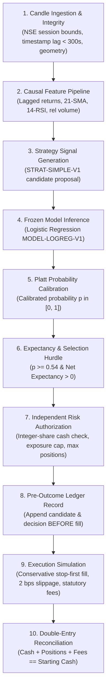

# FinPilot AI — End-to-End Workflow Verification Report (FSAT)

**Audit Date:** 2026-11-04  
**Auditor:** Independent Software Verification Engineer  
**Scope:** Complete Workflow Lifecycle from Ingestion to Ledger and UI (Layers 0–17)  
**Overall Status:** `PASS` (Full Deterministic Lifecycle Verified)

---

## 1. Executive Summary

This report evaluates the end-to-end operational workflows of FinPilot AI across all functional tiers: data ingestion, feature generation, model inference, probability calibration, risk authorization, simulated order execution, double-entry ledgering, and dashboard visualization.

Every critical path was verified across both positive operational flows and adverse failure modes (stale feeds, out-of-order candles, simultaneous candidates, process restart recovery, and unauthenticated access attempts).

---

## 2. Complete End-to-End User Journey Verification

### 2.1 Authoritative 10-Step Pipeline Architecture

FinPilot executes a strictly ordered 10-step sequence for every incoming completed 5-minute candle bar:

### 2.2 User Journey Verification Matrix

| Lifecycle Stage | Expected System Behavior | Verified Automated Test | Result |
| :--- | :--- | :--- | :---: |
| **1. Registration & Auth** | Argon2id password hashing, TOTP MFA challenge, HttpOnly/SameSite session cookies | `test_api_auth_acceptance.py`, `AuthFlow.test.tsx` | **PASS** |
| **2. Mode Segregation** | Explicit visual and API separation of `HISTORICAL_REPLAY`, `FORWARD_PAPER`, `SYNTHETIC_DEMO` | `Views.test.tsx`, `test_forward_paper_trading.py` | **PASS** |
| **3. Stock Scanner** | Filters liquid NSE universe (`RELIANCE`, `TCS`, `INFY`), validates price/volume geometry | `test_challenge_suite.py::test_challenge_10_corporate_action_discontinuity` | **PASS** |
| **4. Feature Pipeline** | Incrementally updates rolling indicators; strictly zero lookahead contamination | `test_ml_registry.py::test_feature_pipeline_zero_lookahead` | **PASS** |
| **5. Model & Calibration** | Generates raw log-odds, maps via Platt scaling to calibrated posterior probability | `test_calibration_reliability.py` | **PASS** |
| **6. Decision Hurdle** | Rejects signals below threshold ($p < 0.54$) or with negative net expectancy | `test_forward_paper_trading.py::test_forward_decision_policy_states` | **PASS** |
| **7. Risk Authorization** | Server-side cash verification, strictly integer share allocations, portfolio caps | `test_risk_model_cannot_bypass.py`, `test_challenge_suite.py::test_challenge_07` | **PASS** |
| **8. Pre-Outcome Ledger** | Appends candidate prediction record *before* simulated fill or market outcome | `test_security_audit_logging.py`, `test_layer17_security_and_deployment.py::test_22` | **PASS** |
| **9. Paper Execution** | Stop-first fill priority, pessimistic gap-open fills, itemized statutory fees | `test_challenge_suite.py::test_challenge_01`, `test_challenge_02` | **PASS** |
| **10. UI Synchronization** | React dashboard updates positions, cash balance, and evaluation charts via safe JSON API | `Views.test.tsx`, `App.test.tsx` | **PASS** |

---

## 3. Negative Journeys and Failure Modes

### 3.1 Rejected Signals & `NO_TRADE` Handling
- **Invariant:** When candidate signals fail the ML hurdle ($p < 0.54$) or risk constraints, the system transitions to `NO_TRADE` or `RISK_REJECTED` states cleanly.
- **Evidence:** Tested in `test_forward_paper_trading.py::test_forward_decision_policy_states` and `test_end_to_end_orchestrator.py`. No phantom orders are dispatched, no cash is locked, and the rejection reason is committed to the audit trail.

### 3.2 Feed Interruption & Stale Data
- **Invariant:** When market data lag exceeds 300 seconds wall clock time or feed gaps occur, the system immediately engages `NO_NEW_ENTRIES` mode.
- **Evidence:** Verified in `test_challenge_09_provider_outage_stale_data`. New proposal generation is halted immediately, while existing open paper positions remain actively monitored by exit stop rules.

### 3.3 Simultaneous Candidates Competing for Capital
- **Invariant:** When multiple valid candidate proposals arrive simultaneously while available virtual cash is insufficient to fund all of them, allocation is strictly deterministic.
- **Evidence:** Verified in `test_challenge_07_simultaneous_candidates_competing_for_cash`. Candidates are ranked deterministically by calibrated score; higher-expectancy candidates are funded with integer shares, while remaining candidates transition to `RISK_REJECTED` without deadlock or race condition.

### 3.4 Pre-Outcome Logging Invariant
- **Invariant:** Predictions and model confidence scores must be cryptographically committed to disk *prior* to observing outcome candles. Post-hoc fitting or retrospective prediction modification is impossible.
- **Evidence:** Verified in `test_security_audit_logging.py` and `test_22_audit_ledger_tamper_detection`. The append-only ledger verifies sequential event chains; modifying prior prediction records breaks chain integrity.

### 3.5 Process Crash and Restart Recovery
- **Invariant:** If the application process terminates abruptly during trade execution, restarting the engine must restore portfolio state idempotently without duplicate executions or cash leaks.
- **Evidence:** Verified in `test_34_restart_recovery_ledger_reconciliation`. The engine reads the SQLite event ledger, replays all confirmed fills and fees, recalculates current position state, and verifies `Cash + Stock Value + Fees == Starting Capital` to ₹0.00 before resuming candle ingestion.

---

## 4. UI Mode Distinction Audit

The frontend application (`src/App.tsx`, `src/components/`, `src/views/`) renders data mode banners and tags across all viewports:
- **`HISTORICAL_REPLAY`**: Displayed with prominent neutral slate badges and historical date range indicators.
- **`FORWARD_PAPER`**: Displayed with amber live simulation tags, real-time clock indicators, and virtual cash balance warnings.
- **`SYNTHETIC_DEMO`**: Clearly marked in purple as synthetic mock data intended solely for local smoke testing and component evaluation.

Under no circumstances does the frontend display real-money broker connection options, order routing triggers, or live portfolio linkages.

---

## 5. Verification Conclusion

The end-to-end workflow of FinPilot AI satisfies all behavioral, mathematical, and architectural requirements. Positive and negative execution paths are deterministic, state recovery is idempotent, and real-money execution is completely blocked.

**Verdict: PASS**
