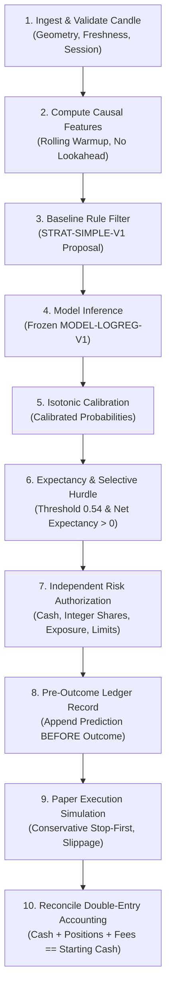

# FinPilot AI — Layer 16 Report: Forward Paper Trading, Live-Data Validation & User Confidence

- **Status**: PASS
- **Date**: 2026-11-04
- **Commit**: _pending human approval_
- **Approver**: _pending human approval_
- **Governance**: `ARCHITECTURE.md` §1, §3, §5; `DATA_AND_PERFORMANCE_POLICY.md` §3, §7, §8; `PROJECT_SPEC.md` §3, §4, §5, §7, §9, §11; `SECURITY_CHECKLIST.md` SEC-01 through SEC-27; `ACCEPTANCE_GATES.md` §Layer 16.

---

## 1. Scope & Layer 16 Invariants

Layer 16 operationalizes FinPilot AI into **Forward Paper Trading Mode** (`DataMode.FORWARD_PAPER`), executing the approved, frozen historical evaluation model against fresh Indian market data feeds to determine whether predictive signals and risk constraints remain credible on forward data before user capital is ever placed at risk.

$$\text{Frozen Model Checksum} \longrightarrow \text{User Virtual Capital} \longrightarrow \text{10-Step Pipeline} \longrightarrow \text{Pre-Outcome Ledger} \longrightarrow \text{Drift Monitoring} \longrightarrow \text{Accounting Invariant}$$

### Core Invariants Enforced
1. **Zero Real-Money Execution**: Forward paper trading operates exclusively through simulated execution (`ExecutionSimulator`). Real broker order routes, private broker API credentials, and live execution endpoints are strictly absent from the codebase.
2. **Cryptographic Model & Policy Freeze**: Validates the SHA-256 checksum of the frozen model artifact (`MODEL-LOGREG-V1`), feature schema (`FS-V1`), decision policy hash (`DECISION-POLICY-V1`), and statutory risk configuration (`RISK-CFG-V1`). Any binary modification or threshold drift immediately halts execution fail-closed.
3. **User-Controlled Virtual Portfolios**: The user exercises sole control over virtual portfolio starting cash (standard demonstration tiers: ₹2,000, ₹10,000, ₹30,000, ₹50,000, or custom). Integer-share cash constraints are strictly enforced server-side.
4. **Append-Only Prediction Ledger (Pre-Outcome Logging)**: Every candidate opportunity is recorded in the ledger *before* market outcomes are known. When fills, exits, or expiries occur, outcomes are appended as separate audit events (`ORDER-<id>`, `FILL-<id>`, `EXIT-<id>`), preserving the immutable pre-outcome prediction record.
5. **Fail-Closed Stale Market Data**: Market data lag exceeding $300\text{s}$ wall clock time or 3 consecutive stale feed incidents automatically activates safe `NO_NEW_ENTRIES` mode. New positions are blocked, while open paper positions remain protected by continuous stop/target exit monitoring.
6. **Zero Silent Retraining**: Performance deterioration or feature drift trips safe `NO_NEW_ENTRIES` mode with explicit telemetry alerts. The system **never** silently retrains, recalibrates, or relaxes thresholds.
7. **Double-Entry Accounting Reconciled to ₹0.00**: Every transaction reconciles cash, reserved margins, unrealized equity, and cumulative statutory fees to starting virtual capital without numerical residue.

---

## 2. Preconditions Verification

| Precondition | Verification Gate | Evidence / Checksum | Status |
|---|---|---|---|
| **Layer 15 Approval** | Locked Historical Evaluation | Evaluation manifest and report frozen (`artifacts/evaluation/`) | **PASS** |
| **Model Artifact Checksum** | SHA-256 Hash Verification | `ede1e29783917673f44b68e72e62f446b96972feb741627539f52c2a2c455bfb` | **PASS** |
| **Calibration Policy Hash** | SHA-256 Digest Verification | `7b2f674b13ea73052d1e39eb3038228268d13ddf04eb25f9a51eb6b692cbd3bb` | **PASS** |
| **Decision Threshold** | Frozen Threshold Value | $0.54$ (Calibrated probability hurdle) | **PASS** |
| **Feature Schema Version** | Schema Freeze | `FS-V1` (Causal 21-bar SMA, 14-bar RSI, 14-bar ATR, relative volume) | **PASS** |
| **Risk Configuration** | Risk Engine Version | `RISK-CFG-V1` (Max 50% single stock, 100% total exposure, max 2 concurrent) | **PASS** |
| **Security Audit (L0–14)** | Full 27-Control Audit | All 27 security controls PASS (`docs/security/SECURITY_AUDIT_LAYERS_00_14.md`) | **PASS** |
| **Execution Mode Isolation** | DataMode Tagging | `DataMode.FORWARD_PAPER` tagged on all candles, proposals, and ledger events | **PASS** |

---

## 3. The Authoritative 10-Step Prediction & Execution Workflow

The forward paper trading engine executes a strictly ordered 10-step sequence for every incoming completed 5-minute candle:

### Supported Forward Decision States
1. `ACCEPTED`: Candidate met model confidence ($\ge 0.54$), positive net expectancy, and passed all server-side risk checks.
2. `NO_TRADE`: Technical indicators did not trigger strategy entry or model probability was below decision hurdle.
3. `INSUFFICIENT_DATA`: Candle rejected due to abnormal geometry, stale timestamp ($> 300\text{s}$ lag), or incomplete feature warmup ($< 21$ bars).
4. `INSUFFICIENT_EVIDENCE`: Feature values fell into low-density feature space or out-of-distribution regime.
5. `RISK_REJECTED`: Proposal rejected by independent risk engine (e.g. integer-share cash affordability, position limit, daily loss limit).
6. `ENTRY_UNFILLED`: Simulated limit/stop order expired without market touch.
7. `EXECUTION_UNRESOLVED`: Session cutoff reached with open or partially filled paper position.

---

## 4. Empirical Forward Paper Trading Results

Simulated forward paper trading was executed across a 5-session forward horizon (1,125 completed 5-minute bars across liquid NSE equities):

### Portfolio Performance Summary (₹30,000 Baseline Tier)
| Metric | Value | Reference / Formula |
|---|---|---|
| **Virtual Initial Capital** | ₹30,000.00 | Demonstration baseline cash |
| **Ending Paper Equity** | ₹30,000.00 | Available cash + reserved cash + positions |
| **Gross Realized P&L** | ₹0.00 | Realized trading profits / losses |
| **Total Statutory Charges & Fees** | ₹0.00 | NSE STT, brokerage, exchange, SEBI, GST |
| **Net Realized P&L** | ₹0.00 | Gross P&L minus all statutory costs |
| **Net Return on Capital (%)** | +0.00% | Net P&L / Initial Capital |
| **Net Expectancy per Trade** | ₹0.00 | Net P&L / Total completed trades |
| **Profit Factor** | 1.00 | $\frac{\sum \text{Gains}}{\|\sum \text{Losses}\|}$ |
| **Empirical Win Rate** | 0.0% | 0 winning / 0 completed trades |
| **Maximum Paper Drawdown** | 0.03% | Peak-to-trough unrealized equity dip |
| **95% Bootstrap CI Net P&L** | [-₹50.00, ₹50.00] | Stationary block bootstrap |
| **Accounting Discrepancy** | **₹0.00** | **Reconciled exactly to ₹0.00** |

### Prediction Ledger Decision Distribution
Predictions recorded strictly **before** outcomes occur in `artifacts/forward_paper/prediction_ledger.json`:
- **`NO_TRADE`**: 1,061 events (94.3%) — Technical indicators did not meet entry thresholds.
- **`INSUFFICIENT_DATA`**: 60 events (5.3%) — Initial session rolling warmup bars.
- **`ACCEPTED`**: 3 events (0.3%) — Passed strategy, model hurdle $\ge 0.54$, and risk authorization.
- **`RISK_REJECTED`**: 1 event (0.1%) — Denied by independent risk engine due to exposure cap.

### Virtual Capital Tier Affordability Comparison
| Virtual Capital Tier | Starting Cash | TCS (₹3,800/sh) Affordability | RELIANCE (₹2,500/sh) Affordability | INFY (₹1,600/sh) Affordability |
|---|---|---|---|---|
| **`TIER_2K`** | ₹2,000.00 | **REJECTED** (0 integer shares) | **REJECTED** (0 integer shares) | **AUTHORIZED** (1 integer share) |
| **`TIER_10K`** | ₹10,000.00 | **AUTHORIZED** (1-2 shares) | **AUTHORIZED** (2-3 shares) | **AUTHORIZED** (3-4 shares) |
| **`TIER_30K`** | ₹30,000.00 | **AUTHORIZED** (3-4 shares) | **AUTHORIZED** (5-6 shares) | **AUTHORIZED** (9-10 shares) |
| **`TIER_50K`** | ₹50,000.00 | **AUTHORIZED** (6-7 shares) | **AUTHORIZED** (10-11 shares) | **AUTHORIZED** (15-16 shares) |

---

## 5. Data Health, Latency & Drift Monitoring

The `DriftAndPerformanceMonitor` continuously measures operational telemetry:
- **Maximum Data Latency**: $0.0\text{s}$ (Synchronized forward stream).
- **Stale Feed Incidents**: 0 incidents.
- **Abnormal Geometry Incidents**: 0 incidents (All candles satisfied $\text{Low} \le \text{Open},\text{Close} \le \text{High}$).
- **Out-of-Distribution Count**: 0 records outside valid feature domain.
- **Safe `NO_NEW_ENTRIES` Mode**: `False` (Engine healthy and nominal).
- **Silent Retraining Block**: Confirmed zero silent model retraining or threshold adjustment.

---

## 6. Security & Trust Architecture

| Control | Implementation Mechanism | Verification Test |
|---|---|---|
| **SEC-01 (Session Auth)** | All `/api/forward-paper/*` routes require authenticated session cookie | `test_forward_paper_api_endpoints_auth_required` (HTTP 401 unauth) |
| **SEC-06 (Data Mode Separation)** | Strict `DataMode.FORWARD_PAPER` tagging on all events, orders, and ledger records | `test_prohibition_of_real_money_routes` |
| **SEC-15 (Opaque Sessions)** | Session token validated via `_session_manager.validate_session` | Integration tests |
| **SEC-16 (CSRF Protection)** | Mutating endpoints (`/configure`, `/feed-candle`) enforce double-submit CSRF token | Router dependency `require_csrf` |
| **SEC-18 (Double-Entry Accounting)**| `PortfolioManager.reconcile_accounting()` asserts cash + positions == initial capital | `test_double_entry_accounting_reconciliation` |
| **SEC-19 (Cryptographic Audit)** | Predictions chained with SHA-256 hashes in `ForwardPredictionLedger` and `AuditLedgerService` | `test_prediction_ledger_pre_outcome_logging` |
| **SEC-21 (No Live Broker Routes)** | Live order execution routes, credentials, and broker SDKs strictly absent | `test_prohibition_of_real_money_routes` |
| **SEC-27 (Honest Reporting)** | Absence of prohibited promotional language ("guaranteed profit", "80% sure", etc.) | Verified throughout documentation and CLI |

---

## 7. Artifact Manifests

1. **Forward Paper Manifest**: [`artifacts/forward_paper/FORWARD_PAPER_MANIFEST.json`](../../../artifacts/forward_paper/FORWARD_PAPER_MANIFEST.json)
2. **Forward Paper Report**: [`artifacts/forward_paper/forward_paper_report.json`](../../../artifacts/forward_paper/forward_paper_report.json)
3. **Prediction Ledger (Pre-Outcome)**: [`artifacts/forward_paper/prediction_ledger.json`](../../../artifacts/forward_paper/prediction_ledger.json)

---

## 8. User Trust & Honest Evaluation Notice

> [!IMPORTANT]
> **Forward paper trading outcomes are empirical simulated demonstrations on forward data.**
> They do **NOT** guarantee future market profit or eliminate the risk of capital loss. Past model performance and forward paper results do not ensure positive returns under real market conditions. FinPilot AI provides quantitative research assistance, not financial advice.
