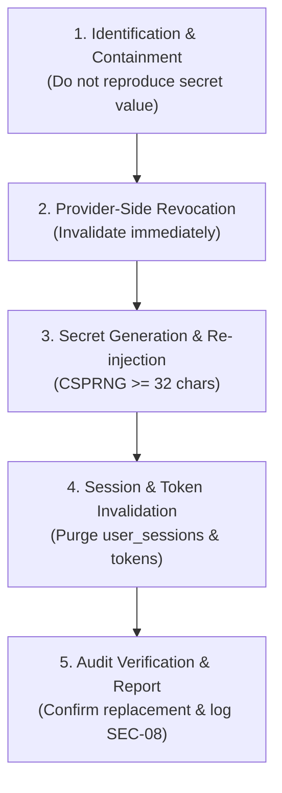

# FinPilot AI — Operational Runbook

Governed by:
- `ARCHITECTURE.md` §1, §3, §5
- `DATA_AND_PERFORMANCE_POLICY.md` §2, §7
- `SECURITY_CHECKLIST.md` SEC-01, SEC-06, SEC-08, SEC-09, SEC-12, SEC-15, SEC-16, SEC-19
- Layer 14 Gate: End-to-End Paper Workflow and Simulator & Security Challenge Suite

---

## 1. System Overview & Architecture

The FinPilot operational paper execution architecture is an integrated, event-driven pipeline:

$$\text{Data Ingestion} \longrightarrow \text{Causal Features (FS-V1)} \longrightarrow \text{Model Calibration & Decision (L10)} \longrightarrow \text{Independent Risk Engine (L11)} \longrightarrow \text{Execution Simulator (L6)} \longrightarrow \text{Cryptographic Audit Ledger (L12)} \longrightarrow \text{Portfolio State (L6)}$$

### Core Operational Invariants
1. **Deny-by-Default Authorization**: Trading algorithms and ML models cannot place orders or authorize trades. Every order proposal requires an un-tampered, cryptographically signed `RiskAuthorization` issued by `RiskEvaluator`.
2. **Causal Separation**: Fills are never executed retroactively at signal candle completion. Orders execute against subsequent market bars obeying volume participation caps ($\le 10\%$) and limit penetration semantics.
3. **Fail-Closed Market Data**: Feed delay $> 300\text{s}$ or out-of-order candle sequences trigger immediate rejection (`DATA_STALE`), logging `PROVIDER_FAILURE` security events.
4. **Strict Isolation of Forward Paper**: Forward Paper (`DataMode.FORWARD_PAPER`) is strictly isolated from live broker order routing interfaces. Live money handling is strictly out of scope in V1.
5. **Deterministic Replay & Hash Chaining**: All ledger state transitions are chained using SHA-256 hashes ($H_n = \text{SHA256}(H_{n-1} \parallel \dots)$), permitting bit-for-bit replay and tamper detection.

---

## 2. Trading Session & Schedule (NSE Cash Equities)

All operations strictly observe Asia/Kolkata (`IST`, UTC+05:30) regular equity trading session bounds:

| Phase | Time (IST) | Operational Rule |
|---|---|---|
| **Pre-Market Buffer** | 09:00 – 09:15 | Market data connection health checks; database connectivity verification. |
| **Market Open** | 09:15 | Daily session reset; initial portfolio equity evaluation (₹30,000 base capital). |
| **Active Trading** | 09:15 – 15:00 | 5-minute candle completion triggers feature extraction, selective candidate scoring, risk authorization, and simulated matching. |
| **Session Entry Cutoff** | 15:00:00 | **Strict No-Entry Barrier**: Risk engine rejects all new entry proposals (`SESSION_ENTRY_CUTOFF`). |
| **Forced Square-Off Cutoff** | 15:15:00 | **Mandatory Position Close**: Simulator forces exit on open intraday positions (`SESSION_CUTOFF`). If market data is halted/zero volume, position is marked `UNRESOLVED` without fabricating fills. |
| **Session Close** | 15:30:00 | End-of-day ledger hash chain verification and accounting reconciliation. |

---

## 3. Clock Architecture & Freshness Policy

FinPilot employs an explicit injectable clock abstraction across all workflows:

- **Historical Replay (`DataMode.HISTORICAL_REPLAY`)**:
  - Reference time is governed by the simulated replay clock / candle timestamp cursor ($t_{\text{replay}}$).
  - Freshness check enforces monotonic bar sequencing ($t_{\text{candle}} \ge t_{\text{last\_processed}}$).
  - Retroactive past candles or out-of-order timestamps are blocked and flagged `DATA_STALE`.
- **Forward Paper (`DataMode.FORWARD_PAPER`) / Live**:
  - Reference time is governed by `datetime.now(UTC)`.
  - Freshness check enforces lag tolerance $\le 300\text{s}$:
    $$\Delta t = t_{\text{wall\_clock}} - t_{\text{bar}} \le 300\text{s}$$
  - Feed outages or provider interruptions exceeding $300\text{s}$ block new trade entries while preserving protective exit monitoring.

---

## 4. Crash Recovery & Ledger Replay Procedure

When the FinPilot workflow process terminates unexpectedly (e.g., process crash, unhandled exception, power disruption):

```python
from finpilot.workflow.orchestrator import EndToEndPaperWorkflow

# 1. Instantiate workflow engine bound to the existing database
workflow = EndToEndPaperWorkflow(db=persistent_db_session)

# 2. Trigger automated recovery and cryptographic verification
recovery_result = workflow.recover_from_crash()

# 3. Assert recovery integrity
assert recovery_result["chain_verified"] is True
print(f"Reconstructed Cash: ₹{recovery_result['recovered_cash']}")
print(f"Reconstructed Realized P&L: ₹{recovery_result['recovered_realized_pnl']}")
print(f"Events Replayed: {recovery_result['events_replayed']}")
```

### Verification Guarantees
- The audit ledger inspects the sequential SHA-256 hash chain starting from `GENESIS_PREV_HASH`.
- Reconstructs exact point-in-time cash balance, open integer share positions, and cumulative realized P&L.
- Detects any payload tampering or out-of-band database modifications with `tamper_detected = True`.

---

## 5. Emergency Procedures & Administrative Controls

### 5.1 Emergency Kill-Switch Actuation
To instantly halt all new order placement across all models and strategies:
- **CLI / Backend**:
  ```python
  workflow.risk_evaluator.config = workflow.risk_evaluator.config.model_copy(
      update={"kill_switch_active": True}
  )
  ```
- **API Endpoint**: `POST /api/risk/kill-switch` with payload `{"active": true}`.
  - Requires `UserRole.ADMIN` session token and valid `X-CSRF-Token`.
  - Unauthenticated or non-admin attempts receive `401 Unauthorized` or `403 Forbidden` and trigger `SECURITY_AUDIT` logging.

### 5.2 Manual Trading Pause
To temporarily pause trade authorizations without activating the emergency circuit breaker:
- Update `manual_trading_paused = True` in `RiskConfig`.
- Open positions continue to be monitored for stop-loss or session cutoff exits.

---

## 6. Running the Simulator & Security Challenge Suite

FinPilot includes a 17-scenario automated challenge suite verifying simulator matching edge cases, pipeline hygiene, and security gates:

```powershell
# Run the entire challenge suite (17 challenges + sequence test)
py -m pytest backend/tests/workflow/test_challenge_suite.py -vv

# Run end-to-end replay accounting and crash recovery tests
py -m pytest backend/tests/workflow/test_end_to_end_orchestrator.py -vv

# Run security audit logger and secret redaction tests
py -m pytest backend/tests/workflow/test_security_audit_logging.py -vv
```

All 26 workflow tests must pass with 0 failures before any deployment or evaluation run.

---

## 7. Compromised Key Handling & Credential Revocation Protocol (SEC-25)

Governed by:
- `SECURITY.md` §4, §9
- `SECURITY_CHECKLIST.md` SEC-02, SEC-24, SEC-25
- NIST SP 800-63B-4

This section defines the mandatory incident response procedures if any production, staging, or provider credential is leaked, committed, or suspected of compromise.

### 7.1 Credential Classification & Impact

| Credential Type | Storage / Injection | Compromise Impact | Rotation Authority |
|---|---|---|---|
| **`FINPILOT_SECRET_KEY`** | Server env only (`FINPILOT_SECRET_KEY`) | Forgery of CSRF tokens and session signatures | DevOps / Lead Engineer |
| **Database Credentials** | Server env only (`DATABASE_URL`) | Database read/write, ledger manipulation | DB Administrator / DevOps |
| **Market Data Provider API Keys** | Server env only (`DATA_PROVIDER_*`) | Data quota theft, feed manipulation | Data Provider Portal Admin |
| **User Passwords / Argon2id Hashes** | Database `users` table | Account takeover | User via Reset / Admin |
| **Admin TOTP Secrets** | Database `users.mfa_secret` | Admin route access bypass | Admin via `/api/auth/mfa/setup` |
| **Session Tokens** | `user_sessions` table (SHA-256 hashed) | Hijack of active browser sessions | Automated revocation / Admin |

### 7.2 Five-Phase Incident Response Protocol



#### Phase 1: Identification & Containment (Immediate)
1. **Identify Exposed Key**: Determine the credential type, affected service, and exposure channel (e.g., git commit, log output, accidental paste).
2. **Strict Invariant**: **NEVER print, reproduce, or commit the actual secret value** in tickets, chat, terminal logs, or security audit reports. Refer to the key only by its name, type, and sha256 checksum prefix.
3. If market execution or risk authorization is at immediate risk, actuate the **Emergency Kill Switch** (`POST /api/risk/kill-switch` with `active: true`).

#### Phase 2: Provider-Side Revocation
1. Log into the credential provider's authoritative console (e.g., PostgreSQL management portal, Cloud provider IAM, market data vendor dashboard).
2. **Revoke the compromised credential immediately** on the provider side.
3. **Mandatory Prohibition**: **Never claim a key has been revoked unless actual revocation was verified with the provider.** An assertion or documentation update without provider confirmation does NOT constitute revocation.

#### Phase 3: Generation & Secure Re-Injection
1. Generate a new high-entropy secret using a cryptographically secure pseudorandom number generator (CSPRNG):
   - For `FINPILOT_SECRET_KEY`: minimum 32 characters (`python -c "import secrets; print(secrets.token_urlsafe(48))"`).
   - For Database passwords: minimum 24 characters with mixed entropy.
2. Inject the replacement secret into the secure server environment (e.g., AWS Secrets Manager, HashiCorp Vault, or deployment environment variables).
3. Confirm that no `.env` file containing the secret is committed or stored in git.

#### Phase 4: Session & Token Invalidation
1. **Invalidate all active sessions**:
   ```sql
   UPDATE user_sessions SET is_revoked = 1, last_activity = datetime('now');
   ```
2. **Invalidate all outstanding password reset tokens**:
   ```sql
   UPDATE password_reset_tokens SET is_used = 1 WHERE is_used = 0;
   ```
3. Restart backend service instances to load new settings and flush in-memory authentication caches.

#### Phase 5: Verification & Tamper Audit
1. Run test suite against the freshly injected environment to verify connectivity:
   ```powershell
   py -m pytest backend/tests/test_config.py backend/tests/test_api_auth_acceptance.py
   ```
2. Run `gitleaks git --config .gitleaks.toml --redact` to confirm git history hygiene.
3. Inspect the cryptographic audit ledger (`GET /api/ledger/replay` or `orchestrator.recover_from_crash()`) to verify no unauthorized transactions were inserted during the compromise window.
4. Record an incident log in `docs/exception-register.md` or security incident logs detailing root cause, rotation timestamp, and verifying engineer.
