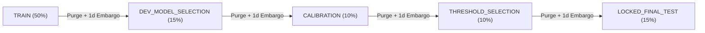

# FinPilot AI — Temporal Validation Protocol & Labeling Design

Status: **Ratified (Layer 8)**  
Related: `PROJECT_SPEC.md` §4, §7, `DATA_AND_PERFORMANCE_POLICY.md` §2, §7, `docs/trade-policy-contract-v1.md`, `docs/execution-policy.md`.

---

## 1. Research Philosophy & Causal Invariants

FinPilot AI implements a strict, leakage-resistant temporal validation protocol designed specifically for **intraday Indian cash equity trading**. Standard machine learning approaches in financial literature suffer from multiple systemic flaws:
1. **Generic Price-Rise Labeling**: Labeling a sample positive simply because $P_{t+k} > P_t$ ignores bid-ask spread, executable entry delays, stop losses, take profits, intra-session cutoffs, and statutory costs.
2. **K-Fold Random Shuffling & Temporal Leakage**: Randomly splitting time series leaks past autocorrelation and future regimes into training sets.
3. **Cross-Symbol Time Inversion**: Allowing Symbol A's later calendar dates into training while Symbol B's earlier dates are held out leaks macro market regimes.
4. **Boundary Information Spillover**: Ignoring the trade outcome horizon $[t_{\text{entry}}, t_{\text{exit}}]$ allows information from evaluation folds to leak into preceding training folds.

FinPilot's Layer 8 architecture completely eliminates these flaws through server-authoritative trade-policy labeling, globally chronological multi-symbol partitioning, boundary overlap purging, horizon-justified embargoes, and a sealed final-test lockbox.

---

## 2. Trade-Policy Labeling Framework

### 2.1 Approach Selection: Approach A vs Approach B

The project evaluated two potential labeling methodologies:

| Methodology | Description | Selection Status | Rationale |
|---|---|---|---|
| **Approach A (Shared Sizing & Statutory Costs)** | A unified quantity/sizing convention shared by label generation and portfolio simulation. Sizing is computed for a ₹30,000 account (1% risk = ₹300, 20%–50% exposure cap, integer shares). Full statutory fees (`NSE_EQUITY_INTRADAY_V1`) and 2.0 bps slippage are applied directly to calculate Net P&L. Binary label is $1$ **only if Net P&L > ₹0.00**. | **SELECTED (MVP Standard)** | Indian equity intraday trading is dominated by statutory friction (STT on sell, GST, stamp duty, turnover charges, brokerage). Labeling with realistic costs prevents the ML model from learning false-positive micro-edges that cannot survive fee drag. |
| **Approach B (Gross Modeling with Downstream Costs)** | Model gross price path outcomes (e.g. 1 unit) and apply quantity-specific transaction costs downstream in the portfolio simulation engine. | Documented Alternative (Not Used for MVP) | Fails to penalize low-notional setups during model training where statutory percentage drag is highest. |

> [!IMPORTANT]
> **No Double-Counting Rule**: Because Approach A accounts for complete statutory costs, slippage, and integer sizing during ground-truth label generation, downstream model scoring understands true net edge. Downstream evaluation engines must never double-subtract transaction costs.

### 2.2 Trade Policy Mechanics (`TP-V1`)

For every completed 5-minute candle at $t_{\text{decision}}$:
1. **Executable Entry Delay**: Signals never fill retroactively at the decision candle's close. Executable entry occurs strictly at the **open of the next 5-minute candle** ($t_{\text{entry}} = t_{\text{decision}} + 5\text{m}$) adjusted for 2.0 basis points modelled slippage:
   $$P_{\text{entry}} = \text{round\_paisa}\left(\text{Open}_{t+1} \times \left(1 + \frac{2.0}{10000}\right)\right)$$
2. **Integer Risk Sizing**:
   $$Q = \max\left(1, \min\left(\left\lfloor \frac{\text{Equity} \times \text{Risk\%}}{P_{\text{entry}} - P_{\text{stop}}} \right\rfloor, \left\lfloor \frac{\text{Equity} \times \text{Exposure\%}}{P_{\text{entry}}} \right\rfloor\right)\right)$$
3. **Forward Path Evaluation**: The position steps through subsequent bars in the session:
   - **Stop Loss Breach**: If $\text{Low} \le P_{\text{stop}}$, exit triggers. If the market gapped down past the stop ($\text{Open} < P_{\text{stop}}$), fill occurs at $\text{Open}$ (`GAP_STOP_HIT`).
   - **Take Profit Breach**: If $\text{High} \ge P_{\text{target}}$, exit fills at $P_{\text{target}}$ (`TARGET_HIT`).
   - **Same-Bar Collision**: If $\text{Low} \le P_{\text{stop}}$ AND $\text{High} \ge P_{\text{target}}$ on the same bar, conservative treatment triggers stop loss first (`SAME_BAR_AMBIGUOUS_STOP`).
   - **Max Holding Expiry**: Positions reaching 6 bars (30 minutes) square off at bar open (`MAX_HOLDING_EXPIRY`).
   - **Mandatory Cutoff**: Positions open at 15:15 IST square off immediately at bar open (`SESSION_SQUARE_OFF`).
4. **Binary Ground-Truth Label**:
   $$y = \begin{cases} 1 & \text{if } \text{Net P\&L} > \text{₹0.00} \\ 0 & \text{if } \text{Net P\&L} \le \text{₹0.00} \end{cases}$$

---

## 3. Globally Chronological Multi-Symbol Partitions

FinPilot partitions historical data into **5 strictly chronological sequential windows**:

### 3.1 Partition Purpose & Role Separation

1. **`TRAIN` (50%)**: Feature engineering fit, model parameter estimation, and representation learning.
2. **`DEV_MODEL_SELECTION` (15%)**: Model family comparison (e.g. LightGBM vs Logistic Baseline), feature pruning, and hyperparameter optimization.
3. **`CALIBRATION` (10%)**: Out-of-sample probability calibration (Platt scaling / Isotonic regression) to ensure model confidence scores match true empirical win rates.
4. **`THRESHOLD_SELECTION` (10%)**: Tuning decision thresholds ($\tau$) to optimize economic utility and precision under transaction costs, strictly isolated from training data.
5. **`LOCKED_FINAL_TEST` (15%)**: Locked, unseen test partition reserved solely for official Layer 11/20 evaluation campaigns.

### 3.2 Global Cross-Symbol Chronological Invariant

Partition boundaries are defined along the **global calendar timeline across ALL symbols**:
$$\forall s_1, s_2 \in \text{Universe}, \quad \max_{t \in \text{TRAIN}(s_1)}(t) < \min_{t \in \text{DEV}(s_2)}(t) < \dots < \min_{t \in \text{TEST}(s_2)}(t)$$

No symbol may contribute training observations from a calendar date while another symbol's data from an earlier or contemporaneous calendar date is held out.

---

## 4. Boundary Overlap Purging Mechanics

A trade initiated at decision candle $t_{\text{decision}}$ has an outcome interval $[t_{\text{decision}}, t_{\text{exit}}]$.

If partition $P_k$ has a cutoff boundary $T_{k, \text{end}}$ and partition $P_{k+1}$ begins at $T_{k+1, \text{start}}$:
- Any trade in $P_k$ whose exit timestamp $t_{\text{exit}} \ge T_{k+1, \text{start}}$ extends past the boundary into the subsequent partition.
- **Purging Rule**: Any such trade is **permanently purged** from $P_k$.
- Purged row counts are audited and recorded in `PartitionManifest.purged_count`.

---

## 5. Horizon-Justified Embargo Specification

Between consecutive partitions $P_k$ and $P_{k+1}$, an **embargo window of 1 full trading session** (75 completed 5-minute bars / 1 business day) is enforced:

### Justification:
1. **Intraday Trade Horizon**: All trades under `TP-V1` are strictly intraday and forced flat by 15:15 IST (maximum holding duration $\le 72$ bars).
2. **Feature Indicator Lookback Horizon**: The FS-V1 causal feature catalog uses rolling windows up to 21 bars (105 minutes for SMA-21) and 14 bars (70 minutes for RSI/ATR).
3. **Autocorrelation & Volatility Clustering**: Returns and volume regimes in Indian equities exhibit high serial autocorrelation and GARCH persistence across trading days.
4. **Weekend / Overnight Boundary Separation**: An embargo of 1 full session guarantees that overnight gaps and next-day open shocks do not correlate boundary samples.

Any candidate decision candle falling within the embargo buffer $[T_{k, \text{end}}, T_{k, \text{end}} + \text{Embargo}]$ is completely excluded from all partitions.

---

## 6. Locked Final Test Lockbox Protocol

To satisfy **ACCEPTANCE_GATES.md (G-8, Unseen data)** and prevent research snooping or data dredging:
1. **Sealed Container (`FinalTestLockbox`)**: The `LOCKED_FINAL_TEST` partition is sealed upon creation.
2. **Cryptographic Digest**: The SHA-256 hash of all sorted `sample_id`s in the test set is recorded in `SplitManifest.locked_final_test_hash`.
3. **Routine Access Blocked**: Calling `get_final_test_samples()` without the exact unseal token raises `FinalTestLockedError`.
4. **Tamper Verification**: Unsealing verifies that the computed hash of the test samples matches `locked_final_test_hash` exactly.

---

## 7. Historical Universe & Survivorship Limitations

> [!WARNING]
> **Explicit Survivorship Bias Limitation Disclosure**  
> In Indian equity market data, historical delisting and constituent records for NIFTY 50 and NIFTY 500 prior to recent years are incomplete in standard retail vendor feeds. While FinPilot enforces Point-In-Time universe eligibility on all registered instruments (`PointInTimeUniverseManager`), survivorship bias cannot be claimed fully eliminated for delisted entities outside the historical coverage window. This limitation is formally recorded in all split manifests and research reports.
